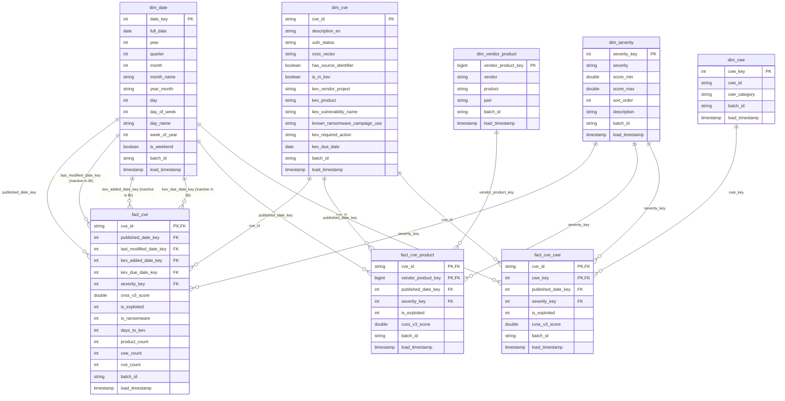

# Gold Data Model: VulnPulse Star Schema

> Generated from [`src/vulnpulse/gold/ddl.py`](../src/vulnpulse/gold/ddl.py) by
> `python scripts/gen_gold_model.py > docs/GOLD_MODEL.md`. Do not edit by hand.

All tables are Delta in `workspace.vulnpulse_gold`, created idempotently by `notebooks/04_gold`,
with informational PRIMARY KEY / FOREIGN KEY constraints in Unity Catalog. Every row carries
`batch_id` (Gold run id) and `load_timestamp` (UTC). Dimensions are SCD type 1 (MERGE),
facts are MERGE upserts on their primary key; `dim_date` and `dim_severity` are generated.

**5 dimensions:** `dim_date`, `dim_severity`, `dim_cve`, `dim_vendor_product`, `dim_cwe`.  
**3 facts:** `fact_cve`, `fact_cve_product`, `fact_cve_cwe`.  
**1 view:** `gold_watchlist_v` (exploited, or CVSS ≥ 9.0 and published in the last 90 days).

## Entity-relationship diagram

Every relationship is one-to-many from the dimension to the fact. `dim_date` plays four roles
for `fact_cve`; Power BI allows one active relationship per table pair, so `published` is active
and the other three are used with `USERELATIONSHIP`.

## Why three facts

`fact_cve` is one row per CVE, the grain for counts, trends and days-to-KEV (Q1, Q4, KPIs).
A CVE affects many products and can have several weaknesses, so vendor and weakness rankings
(Q2, Q3) use the bridge facts `fact_cve_product` (CVE × vendor/product) and `fact_cve_cwe`
(CVE × CWE). Each bridge row repeats the CVE's `published_date_key`, `severity_key`,
`cvss_v3_score` and `is_exploited`, derived with the same key expressions as `fact_cve`, so
date, severity and KEV slicers filter all three facts consistently without double-counting
CVE totals.

## Relationships

| Fact column | Dimension | Role | Active in Power BI |
|---|---|---|---|
| `fact_cve.cve_id` | `dim_cve.cve_id` | - | yes |
| `fact_cve.published_date_key` | `dim_date.date_key` | published | yes |
| `fact_cve.last_modified_date_key` | `dim_date.date_key` | last_modified | no |
| `fact_cve.kev_added_date_key` | `dim_date.date_key` | kev_added | no |
| `fact_cve.kev_due_date_key` | `dim_date.date_key` | kev_due | no |
| `fact_cve.severity_key` | `dim_severity.severity_key` | - | yes |
| `fact_cve_product.cve_id` | `dim_cve.cve_id` | - | yes |
| `fact_cve_product.vendor_product_key` | `dim_vendor_product.vendor_product_key` | - | yes |
| `fact_cve_product.published_date_key` | `dim_date.date_key` | published | yes |
| `fact_cve_product.severity_key` | `dim_severity.severity_key` | - | yes |
| `fact_cve_cwe.cve_id` | `dim_cve.cve_id` | - | yes |
| `fact_cve_cwe.cwe_key` | `dim_cwe.cwe_key` | - | yes |
| `fact_cve_cwe.published_date_key` | `dim_date.date_key` | published | yes |
| `fact_cve_cwe.severity_key` | `dim_severity.severity_key` | - | yes |

## Data dictionary

### Dimensions

### `dim_date` (dimension)

Calendar dimension, one row per day 1988-2030. Primary key: `(date_key)`.

| Column | Type | Null | Key | Description |
|---|---|---|---|---|
| `date_key` | INT | no | PK | yyyymmdd integer, e.g. 20261023 |
| `full_date` | DATE | no |  | Calendar date |
| `year` | INT | no |  |  |
| `quarter` | INT | no |  |  |
| `month` | INT | no |  |  |
| `month_name` | STRING | no |  |  |
| `year_month` | STRING | no |  | '2026-10' |
| `day` | INT | no |  |  |
| `day_of_week` | INT | no |  | 1 = Monday .. 7 = Sunday |
| `day_name` | STRING | no |  |  |
| `week_of_year` | INT | no |  |  |
| `is_weekend` | BOOLEAN | no |  |  |
| `batch_id` | STRING | no |  | Gold run id that last wrote the row |
| `load_timestamp` | TIMESTAMP | no |  | UTC time the row was last written |

### `dim_severity` (dimension)

CVSS v3 severity bands (CRITICAL, HIGH, MEDIUM, LOW, NONE, UNKNOWN). Primary key: `(severity_key)`.

| Column | Type | Null | Key | Description |
|---|---|---|---|---|
| `severity_key` | INT | no | PK | 1 CRITICAL, 2 HIGH, 3 MEDIUM, 4 LOW, 5 NONE, 6 UNKNOWN |
| `severity` | STRING | no |  | CVSS v3 severity band |
| `score_min` | DOUBLE | yes |  | Lowest CVSS v3 score in the band |
| `score_max` | DOUBLE | yes |  | Highest CVSS v3 score in the band |
| `sort_order` | INT | no |  | Display order, most severe first |
| `description` | STRING | yes |  |  |
| `batch_id` | STRING | no |  | Gold run id that last wrote the row |
| `load_timestamp` | TIMESTAMP | no |  | UTC time the row was last written |

### `dim_cve` (dimension)

Descriptive attributes of a CVE plus CISA KEV attributes when listed (SCD type 1). Primary key: `(cve_id)`.

| Column | Type | Null | Key | Description |
|---|---|---|---|---|
| `cve_id` | STRING | no | PK | NVD identifier, e.g. CVE-2024-3400 (natural key) |
| `description_en` | STRING | yes |  | English description |
| `vuln_status` | STRING | yes |  | NVD analysis status (Analyzed, Modified, ...) |
| `cvss_vector` | STRING | yes |  | CVSS v3 vector string |
| `has_source_identifier` | BOOLEAN | yes |  | Submitter identifier was present (the identifier itself is PII, never stored) |
| `is_in_kev` | BOOLEAN | no |  | Listed in CISA KEV |
| `kev_vendor_project` | STRING | yes |  | Vendor as named by CISA |
| `kev_product` | STRING | yes |  | Product as named by CISA |
| `kev_vulnerability_name` | STRING | yes |  | CISA vulnerability title |
| `known_ransomware_campaign_use` | STRING | yes |  | Known | Unknown |
| `kev_required_action` | STRING | yes |  | CISA remediation instruction |
| `kev_due_date` | DATE | yes |  | Federal remediation deadline |
| `batch_id` | STRING | no |  | Gold run id that last wrote the row |
| `load_timestamp` | TIMESTAMP | no |  | UTC time the row was last written |

### `dim_vendor_product` (dimension)

Vendor and product parsed from CPE 2.3 criteria (SCD type 1). Primary key: `(vendor_product_key)`.

| Column | Type | Null | Key | Description |
|---|---|---|---|---|
| `vendor_product_key` | BIGINT | no | PK | xxhash64(lower(trim(vendor)) | lower(trim(product))) |
| `vendor` | STRING | no |  | CPE vendor, lower-cased |
| `product` | STRING | no |  | CPE product, lower-cased |
| `part` | STRING | yes |  | CPE part: a = application, o = operating system, h = hardware |
| `batch_id` | STRING | no |  | Gold run id that last wrote the row |
| `load_timestamp` | TIMESTAMP | no |  | UTC time the row was last written |

### `dim_cwe` (dimension)

Weakness identifiers seen in NVD (SCD type 1). Primary key: `(cwe_key)`.

| Column | Type | Null | Key | Description |
|---|---|---|---|---|
| `cwe_key` | INT | no | PK | Numeric part of CWE-n; -1 = NVD-CWE-noinfo; -2 = NVD-CWE-Other |
| `cwe_id` | STRING | no |  | CWE-79, NVD-CWE-noinfo, NVD-CWE-Other |
| `cwe_category` | STRING | no |  | CWE | NVD-CWE-noinfo | NVD-CWE-Other |
| `batch_id` | STRING | no |  | Gold run id that last wrote the row |
| `load_timestamp` | TIMESTAMP | no |  | UTC time the row was last written |

### Facts

### `fact_cve` (fact)

One row per CVE: dates, severity, exploitation flags, days to KEV, counts. Primary key: `(cve_id)`. Liquid clustering: `published_date_key, severity_key`.

| Column | Type | Null | Key | Description |
|---|---|---|---|---|
| `cve_id` | STRING | no | PK, FK → dim_cve.cve_id | NVD identifier, e.g. CVE-2024-3400 (natural key) |
| `published_date_key` | INT | no | FK → dim_date.date_key | FK dim_date: NVD publication date |
| `last_modified_date_key` | INT | yes | FK → dim_date.date_key | FK dim_date: last NVD modification |
| `kev_added_date_key` | INT | yes | FK → dim_date.date_key | FK dim_date: date added to KEV (NULL if not listed) |
| `kev_due_date_key` | INT | yes | FK → dim_date.date_key | FK dim_date: KEV due date (NULL if not listed) |
| `severity_key` | INT | no | FK → dim_severity.severity_key | 1 CRITICAL, 2 HIGH, 3 MEDIUM, 4 LOW, 5 NONE, 6 UNKNOWN |
| `cvss_v3_score` | DOUBLE | yes |  | CVSS v3 base score (v3.1 preferred, else v3.0) |
| `is_exploited` | INT | no |  | 1 if in CISA KEV else 0 (summable) |
| `is_ransomware` | INT | no |  | 1 if KEV lists known ransomware use else 0 |
| `days_to_kev` | INT | yes |  | Days from NVD publication to KEV listing |
| `product_count` | INT | yes |  | Affected vendor/products (rows in fact_cve_product) |
| `cwe_count` | INT | yes |  | Weaknesses (rows in fact_cve_cwe) |
| `cve_count` | INT | no |  | Always 1, so COUNT becomes SUM in BI |
| `batch_id` | STRING | no |  | Gold run id that last wrote the row |
| `load_timestamp` | TIMESTAMP | no |  | UTC time the row was last written |

### `fact_cve_product` (fact)

Bridge fact: one row per CVE x affected vendor/product. Primary key: `(cve_id, vendor_product_key)`. Liquid clustering: `vendor_product_key`.

| Column | Type | Null | Key | Description |
|---|---|---|---|---|
| `cve_id` | STRING | no | PK, FK → dim_cve.cve_id | NVD identifier, e.g. CVE-2024-3400 (natural key) |
| `vendor_product_key` | BIGINT | no | PK, FK → dim_vendor_product.vendor_product_key | xxhash64(lower(trim(vendor)) | lower(trim(product))) |
| `published_date_key` | INT | no | FK → dim_date.date_key | FK dim_date: NVD publication date |
| `severity_key` | INT | no | FK → dim_severity.severity_key | 1 CRITICAL, 2 HIGH, 3 MEDIUM, 4 LOW, 5 NONE, 6 UNKNOWN |
| `is_exploited` | INT | no |  | 1 if in CISA KEV else 0 (summable) |
| `cvss_v3_score` | DOUBLE | yes |  | CVSS v3 base score (v3.1 preferred, else v3.0) |
| `batch_id` | STRING | no |  | Gold run id that last wrote the row |
| `load_timestamp` | TIMESTAMP | no |  | UTC time the row was last written |

### `fact_cve_cwe` (fact)

Bridge fact: one row per CVE x weakness. Primary key: `(cve_id, cwe_key)`. Liquid clustering: `cwe_key`.

| Column | Type | Null | Key | Description |
|---|---|---|---|---|
| `cve_id` | STRING | no | PK, FK → dim_cve.cve_id | NVD identifier, e.g. CVE-2024-3400 (natural key) |
| `cwe_key` | INT | no | PK, FK → dim_cwe.cwe_key | Numeric part of CWE-n; -1 = NVD-CWE-noinfo; -2 = NVD-CWE-Other |
| `published_date_key` | INT | no | FK → dim_date.date_key | FK dim_date: NVD publication date |
| `severity_key` | INT | no | FK → dim_severity.severity_key | 1 CRITICAL, 2 HIGH, 3 MEDIUM, 4 LOW, 5 NONE, 6 UNKNOWN |
| `is_exploited` | INT | no |  | 1 if in CISA KEV else 0 (summable) |
| `cvss_v3_score` | DOUBLE | yes |  | CVSS v3 base score (v3.1 preferred, else v3.0) |
| `batch_id` | STRING | no |  | Gold run id that last wrote the row |
| `load_timestamp` | TIMESTAMP | no |  | UTC time the row was last written |

## Lineage

| Gold table | Built from (Silver) | Builder |
|---|---|---|
| `dim_date`, `dim_severity` | generated | `gold/dims_static.py` |
| `dim_cve`, `fact_cve` | `silver_cve` ⟕ `silver_kev`; counts from the bridge facts | `gold/cve.py` |
| `dim_vendor_product`, `fact_cve_product` | `silver_affected_product` (vulnerable = true) ⋈ `silver_cve` ⟕ `silver_kev` | `gold/products.py` |
| `dim_cwe`, `fact_cve_cwe` | `silver_cwe` ⋈ `silver_cve` ⟕ `silver_kev` | `gold/cwe.py` |

