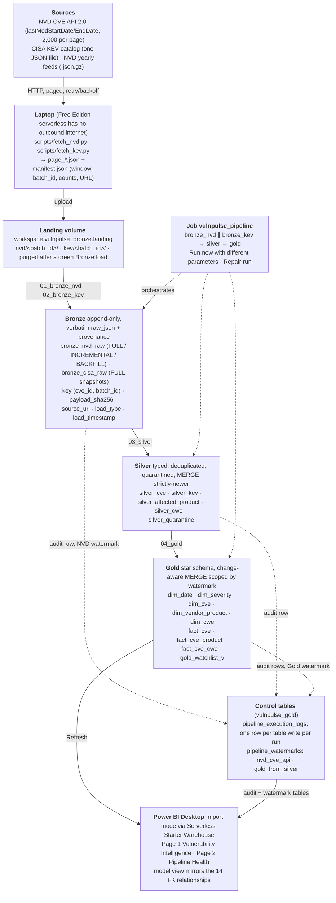
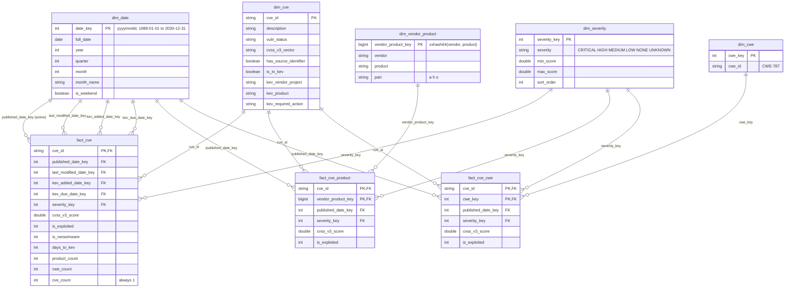
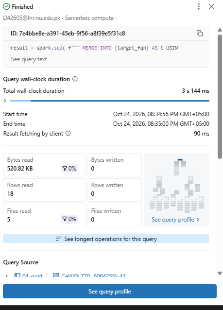

# VulnPulse: Final Architecture and FinOps Report

**Course:** Data Analysis and Visualization, Phase 3  
**Team:** Kashish Fatima (24L-2605), Zahra Saeed (24L-2512)  
**Repository:** https://github.com/kashishfatima999/VulnPulse  
**Dashboard:** `bi/VulnPulse.pbix` (Power BI Desktop, Import mode over Databricks)  
**Date:** 24 October 2026

---

## 1. Executive summary

VulnPulse is a Medallion lakehouse on Databricks Free Edition that turns two public vulnerability
feeds, the NIST National Vulnerability Database (NVD) CVE API 2.0 and the CISA Known Exploited
Vulnerabilities (KEV) catalog, into an analytical star schema and a Power BI dashboard. It answers the
five business questions set in Phase 1: how vulnerability volume and severity move over time, which
vendors carry the most exploited CVEs, which weakness classes (CWE) are exploited most, how long a
CVE takes to reach the KEV list after publication, and which CVEs an operations team should look at
first.

What was built, in one paragraph. Acquisition runs on a laptop because Free Edition serverless has no
outbound internet; the fetch scripts write page files and a `manifest.json` into a landing volume.
Bronze appends every record verbatim with provenance columns. Silver casts, deduplicates, quarantines
and merges into five typed tables. Gold is a star schema of five dimensions, three facts and a
watchlist view, refreshed by change-aware `MERGE` scoped by a watermark. A four-task Databricks Job
runs Bronze → Silver → Gold in one click. Every table write appends a row to
`pipeline_execution_logs`, and two watermark rows in `pipeline_watermarks` drive the incremental
behaviour. Power BI imports Gold directly and mirrors the star in its model view.

Scale at submission, from the audit tables on 24 October 2026:

| Layer | Table | Rows | Note |
|---|---|---|---|
| Bronze | `bronze_nvd_raw` | 70,945 | every version of every CVE record ever loaded, append-only |
| Bronze | `bronze_cisa_raw` | 5,238 | three full KEV snapshots side by side |
| Silver | `silver_cve` | 62,400 | one row per distinct CVE |
| Silver | `silver_affected_product` | 336,225 | one row per CVE × CPE criterion |
| Silver | `silver_cwe` | 56,357 | one row per CVE × CWE |
| Gold | `fact_cve` | 62,400 | CVE grain |
| Gold | `fact_cve_product` | 139,943 | CVE × vendor/product (vulnerable CPEs only) |
| Gold | `fact_cve_cwe` | 56,357 | CVE × CWE |
| Gold | `dim_vendor_product` / `dim_cwe` | 20,390 / 543 | |
| Audit | `pipeline_execution_logs` | 120 | one row per table write per run, successes and failures |

Row counts are derived from the audit log (Silver `rows_read` equals the Bronze row count; Gold totals
are the sum of inserted rows across runs) and are exact as of the 24 October run.

### 1.1 Architecture diagram

Figure 1. Data flow from source to dashboard. Solid arrows carry data; dotted arrows are control:
orchestration, audit rows and watermark advances.

### 1.2 How a daily run works

1. The laptop runs `fetch_nvd.py --start <watermark − 10 min>`; it pages the API in steps of 2,000 and
   writes `page_*.json` plus `manifest.json` (window, batch id, record count, first page URL).
   `fetch_kev.py` downloads the catalog the same way.
2. Both folders are uploaded to the landing volume under their batch ids.
3. The Job is started with the two folder paths as parameters. `bronze_nvd` and `bronze_kev` run in
   parallel; each appends verbatim rows, writes an audit row, and deletes its landing folder.
   `bronze_nvd` advances the NVD watermark to the largest `lastModified` it appended.
4. `silver` reads Bronze, casts and validates, deduplicates to the latest version per key, quarantines
   rows that cannot conform, and `MERGE`s into the five Silver tables with a strictly-newer condition.
5. `gold` finds the CVEs whose Silver rows are newer than the Gold watermark, rebuilds exactly those
   rows in every dimension and fact with a change-aware `MERGE`, then advances the Gold watermark.
6. Power BI **Refresh** re-imports Gold and the audit tables.

On 24 October this took a real week of NVD changes (26,022 records) through the whole chain; the
counts are in section 6 and in `docs/EVIDENCE.md` G8.

---

## 2. Data models

### 2.1 Bronze and Silver (Phase 2, summarised)

Bronze has one grain, one row per source record per batch, and one rule: the record is stored as
received in `raw_json`, with only the business key and the source's modification stamp lifted out
beside it. Both Bronze tables share the same provenance columns (`payload_sha256`, `source_uri`,
`load_type`, `batch_id`, `load_timestamp`), so Silver treats them alike. Bronze is append-only and keyed
by (`cve_id`, `batch_id`); it never updates or deletes, which is what makes every later layer
rebuildable.

Silver is where types, quality and identity live:

| Table | Grain | Key | Source | Notes |
|---|---|---|---|---|
| `silver_cve` | one row per CVE | `cve_id` | `bronze_nvd_raw` | UTC timestamps, CVSS v3.1 falling back to v3.0, severity band, `has_source_identifier` instead of the raw `sourceIdentifier` (PII rule) |
| `silver_kev` | one row per KEV entry | `cve_id` | `bronze_cisa_raw` | DATE casts, ransomware flag, catalog version |
| `silver_affected_product` | one row per CVE × CPE criterion | (`cve_id`, `criteria`) | `bronze_nvd_raw` configurations | CPE 2.3 parsed into part, vendor, product, version bounds; `vulnerable` flag |
| `silver_cwe` | one row per CVE × CWE | (`cve_id`, `cwe_id`) | `bronze_nvd_raw` weaknesses | English descriptions only |
| `silver_quarantine` | rejected rows with reason | | all | `missing_cve_id`, `unparseable_published`, `invalid_cpe_criteria`, … |

Every Silver write is a `MERGE` whose update branch fires only when the incoming row is strictly newer
(`last_modified_at` for CVEs; content hash plus catalog version for KEV). Re-running on unchanged Bronze
therefore changes nothing, which was proven on every milestone and again on 24 October (G8, attempt 3:
`silver_cve` 0 inserted / 0 updated).

### 2.2 Gold star schema

Five dimensions, three facts, one view. The facts carry integer date keys and a severity key;
descriptive text lives only in dimensions. The authoritative definition is `src/vulnpulse/gold/ddl.py`;
`docs/GOLD_MODEL.md` is generated from it and holds the full data dictionary.

Figure 2. Entity-relationship diagram of the Gold star. Every relationship is one-to-many from
dimension to fact. `dim_date` plays four roles for `fact_cve`; `published` is the active relationship in
Power BI and the other three are used through `USERELATIONSHIP`.

| Table | Grain | Primary key | Refresh | Clustering |
|---|---|---|---|---|
| `dim_date` | one row per day, 15,706 rows | `date_key` | regenerated and overwritten every run | |
| `dim_severity` | six CVSS bands | `severity_key` | regenerated and overwritten | |
| `dim_cve` | one row per CVE | `cve_id` | MERGE, SCD type 1 | |
| `dim_vendor_product` | one row per vendor/product | `vendor_product_key` | MERGE, SCD type 1 | |
| `dim_cwe` | one row per weakness id | `cwe_key` | MERGE, SCD type 1 | |
| `fact_cve` | one row per CVE | `cve_id` | MERGE on key | `CLUSTER BY (published_date_key, severity_key)` |
| `fact_cve_product` | one row per CVE × vendor/product, vulnerable CPEs only | (`cve_id`, `vendor_product_key`) | MERGE | `CLUSTER BY (vendor_product_key)` |
| `fact_cve_cwe` | one row per CVE × CWE | (`cve_id`, `cwe_key`) | MERGE | `CLUSTER BY (cwe_key)` |
| `gold_watchlist_v` | view: in KEV, or CVSS ≥ 9.0 and published in the last 90 days | | always current | |

All eight primary keys and all fourteen foreign keys are also declared as informational constraints in
Unity Catalog, so the relationships are visible in Catalog Explorer and not only in documents.

Why three facts rather than one. A CVE has many affected products and many weaknesses. Putting vendor
on a CVE-grain fact is wrong (which vendor?), and putting everything at CVE × product grain inflates CVE
counts by the number of products. `fact_cve` keeps one row per CVE for volume, severity and
time-to-KEV questions; the two bridge facts answer the per-vendor and per-CWE questions. In Power BI,
vendor counts use `DISTINCTCOUNT(fact_cve_product[cve_id])` so a CVE touching 40 Qualcomm chipsets
counts once.

---

## 3. Decision log

The full log with alternatives and outcomes is `docs/planning/PHASE3_PLAN.md`, section 7. The three
questions the rubric asks explicitly are answered first, then the remaining decisions are summarised.

### 3.1 Why these partition columns? We measured and chose not to partition

Phase 1 planned Hive-style partitioning on `year(published_at)`. In Phase 3 we measured the tables
instead. The largest fact, `fact_cve_product`, is about 140,000 rows, and after four MERGE runs
`fact_cve` was a single 0.27 MB file (`DESCRIBE DETAIL`, evidence G5). Partitioning by year would have
split that into roughly 40 directories of tiny files, which slows reads because Spark pays per file,
and it would also have forced the year to be known before a row could be written.

The replacement is Delta liquid clustering: `CLUSTER BY (published_date_key, severity_key)` on
`fact_cve`, by `vendor_product_key` on `fact_cve_product`, and by `cwe_key` on `fact_cve_cwe`. Those are
the columns the dashboard filters and joins on, so Delta's file statistics let the engine skip files
without physical directories. `OPTIMIZE` is a separate maintenance step behind an `optimize = yes`
widget; we ran it with before-and-after `DESCRIBE DETAIL` and recorded that at this scale it was a
no-op (D6, D6a). The honest answer to "why your partition columns" is therefore: at under a million rows
per table, partitions cost more than they save; clustering keys on the dashboard's filter columns give
the data skipping without the small-file penalty, and the method to compact is in place for when the
tables grow.

### 3.2 How we handled schema drift when it occurred

Drift was treated as expected, not exceptional, and the layering absorbs it in three stages. Bronze
keeps the whole record as a string, so a new field can never break ingestion. Silver parses with an
explicit `StructType` and compares the record's top-level keys with a known-key list; unknown keys are
written to `schema_drift_keys` in the audit row and the batch continues. Rows that cannot conform
(missing key, unparseable date, invalid CPE) go to `silver_quarantine` with a reason rather than
failing the run.

Three real cases occurred:

| Source | Field | When | What happened |
|---|---|---|---|
| NVD | `affected` block | Phase 1 samples, Sep 2026 | Preserved in `raw_json`; listed as known-unmodelled |
| CISA KEV | `forensicTriage` | Phase 1 sample, catalog 2026.09.24 | The schema test flagged it; added to `KEV_RECORD_SCHEMA` as STRING |
| NVD | `vendorComments` | 2020 yearly feed, 9 Oct 2026, and again in every incremental since, including 24 Oct | Detected at Silver run time, logged as `schema_drift_keys: ["vendorComments"]`, batch completed; the field stays available in Bronze if ever needed |

The failure drills in `notebooks/99_failure_drills.py` rehearse the other shapes: a record with a new
key (loaded, logged), a newer `lastModified` for a known CVE (updated), a record without `cve_id`
(quarantined), an unparseable `published` date (quarantined), and a CVSS score sent as a string
(cast succeeds). Each produced the expected audit and quarantine rows (evidence S4).

### 3.3 How we managed PII

The feeds are public registries and carry no customer, financial or credential data. The one
field with a personal-data risk is NVD's `sourceIdentifier`, which for some historical CVEs is a
researcher's personal e-mail address. The rule, set in Phase 1 and enforced in code since Phase 2
(`silver/transform.py`, tested in `tests/test_silver_nvd.py`): the raw value is dropped at Silver and
replaced by a boolean `has_source_identifier`. It never reaches Gold or Power BI. It does exist in
Bronze `raw_json`, because Bronze is the verbatim copy, and Bronze is readable only by the two team
accounts through Unity Catalog grants. Secrets follow the same discipline: the NVD API key is read from
an environment variable on the laptop and never written to the manifest, the log or Git; Power BI's
Databricks credential lives only in Power BI's credential store, not in the `.pbix`.

### 3.4 Other decisions, in brief

| # | Decision | Why |
|---|---|---|
| D1 | Star, not snowflake | Power BI performs best on a star; dimensions are small and one level deep |
| D2 | Three facts: CVE grain plus two bridge facts | Avoids double counting CVEs when counting per vendor or per CWE |
| D3 | Natural key `cve_id`; integer `date_key`; hash surrogate only for vendor/product | Stable, readable keys; surrogates only where the natural key is composite. All PK/FK also declared in Unity Catalog |
| D4 | All Gold writes are MERGE, scoped by a Gold watermark on Silver `load_timestamp`; `mode = full` for rebuilds | Keeps the idempotency story of Phase 2; an incremental touches only changed CVEs (785 of 43,198 on 17 Oct; 25,751 of 62,400 on 24 Oct) |
| D5 | Orchestration with a four-task Databricks Job, parameters per run | Declarative, visible, repairable. `Repair run` re-executes only failed and skipped tasks (used twice on 24 Oct) |
| D7 | Logging reuses `pipeline_execution_logs` unchanged | `rows_read` is the rows aggregated; duration is `finished_at − started_at`; no schema migration on a table two layers already write |
| D8 | Power BI Import mode over the Serverless Starter Warehouse | Fast for users, and the warehouse is idle while people browse |
| D9 | Spark analysis from the serverless query profile | Free Edition serverless does not expose the classic Spark UI; the profile shows the same plan graph |
| D10 | FinOps modelled from measured durations with a written price assumption | Free Edition shows no bill |
| D11 | CPE and CWE parsed in Silver, not Gold | Gold never parses raw JSON; typing and quality belong to Silver |
| D13, D14 | Report as Markdown in the repo exported to PDF; `.pbix` committed with PNG and PDF exports | One reviewable source; a reviewer without Power BI can still see the pages |

Two operational lessons were added on 24 October and are recorded in the runbook: Unity Catalog
privileges are per object and do not follow schema ownership, so each teammate grants the other
`USE SCHEMA, SELECT, MODIFY` at schema level in both directions; and landing folder names must be
exact, because the Bronze notebook refuses an incremental load whose folder has no manifest rather
than guessing a window.

---

## 4. Spark execution analysis: the `fact_cve_product` build and MERGE

### 4.1 What the transformation does

`fact_cve_product` is the most complex write in the pipeline. In `04_gold` section 3b the builder in
`src/vulnpulse/gold/products.py`:

1. reads `silver_affected_product` and keeps only rows with `vulnerable = true`, restricted in
   incremental mode to the set of CVEs changed since the Gold watermark (49,045 rows on 24 Oct, out of
   about 336,000);
2. joins to `silver_cve` for `published_at`, CVSS score and severity, and to `silver_kev` for the
   exploitation flag;
3. aggregates to one row per CVE × vendor/product (a CVE can list many versions of one product), with
   the hash surrogate `vendor_product_key`;
4. `MERGE`s the result into the Delta table on (`cve_id`, `vendor_product_key`), updating only when a
   business column differs.

On 24 October the step read 49,045 Silver rows, inserted 13,862 fact rows, updated 2, and took 9.3 s
(`silver_to_gold_logs_2026-10-24.csv`). The no-op rerun twenty minutes later read 0 and took 5.6 s,
almost all of it fixed overhead.

### 4.2 The plan Spark executed

Figure 3. Serverless query profile of a Gold `MERGE` from `04_gold` (statement type MERGE, Photon,
Spark Connect). The exported profile JSON is `docs/evidence/g8_query_profile_fact_cve_cwe_merge.json`;
its plan graph contains the operators discussed below.

Reading the graph from the leaves to the root, Spark executed the query in these phases:

**Scans with predicate pushdown.** The leaves are `Scan workspace.vulnpulse_silver.silver_affected_product`,
`Scan silver_cve` and `Scan silver_kev`. The `vulnerable = true` filter and the
`load_timestamp > <watermark>` scope are pushed into the Delta scan, so Delta's per-file statistics
(min/max on each column) let the reader skip whole files before reading them. This is why the
incremental scope matters for cost: the scan reads only the files that can contain CVEs newer than the
watermark. In the profile this shows as the `Filter` node sitting directly on the scan and as the
"files read" count being a fraction of the table's files (5 of the table's files, 520 KB, for the
no-op rerun).

**Joins.** `silver_kev` has about 1,750 rows, so Spark chose a broadcast hash join: the small table is
sent to every task and the large side streams through it without a shuffle. The join to `silver_cve` is
larger on both sides in full mode and is executed as a sort-merge join after an `Exchange`
(hash-partitioned on `cve_id`); in incremental mode the scoped side is small and adaptive query
execution (`Adaptive Plan` nodes in the profile) converts it to a broadcast join at runtime.

**Shuffle and aggregation.** The per-CVE × vendor/product aggregation is a two-phase
`HashAggregate`: a partial aggregate inside each task, then a `Shuffle` (`Exchange hashpartitioning`)
on the grouping keys so all rows for one key land in the same partition, then the final
`Grouping Aggregate`. This shuffle is the only wide dependency the build needs and it is the stage
boundary visible as `Shuffle Map Stage` in the profile. `Project` nodes between the stages compute the
derived columns (`vendor_product_key`, `published_date_key`, `severity_key`).

**The MERGE itself.** Delta implements `MERGE INTO` as two passes over the target. First an inner
join between the source and the target on the key finds which target files hold matching rows
(`Merge Into workspace.vulnpulse_gold.fact_cve_product` in the profile). Then only those files are
rewritten with the updated and inserted rows (`Write Into`, `Write Stage`), and an
`Invariant Checker` enforces the NOT NULL constraints of the declared schema. Files without matches
are untouched, which is why liquid clustering on `vendor_product_key` helps: matching rows are
co-located in few files, so the rewrite is small. The change-aware condition
(`WHEN MATCHED AND NOT (s.col <=> t.col AND …)`) is evaluated in the first pass, so an unchanged row
produces no rewrite at all; on the no-op rerun the profile reports 0 bytes and 0 files written.

**Whole-stage code generation and Photon.** The `Whole Stage Codegen` and `Columnar To Row` /
`Row To Columnar` nodes show the narrow operators being fused into single compiled functions and
handed to the Photon vectorised engine, which is on by default for serverless. Compilation took 0.3 s of
the 3.1 s no-op query; execution 2.8 s, of which metadata (reading the Delta log) was 1.5 s. That fixed
overhead of two to three seconds per MERGE is why eight small MERGEs cost about a minute regardless of
row count, and it is the first thing to optimise if the pipeline ran hourly (section 5.4).

---

## 5. Cost and FinOps evaluation

### 5.1 What we could measure

Free Edition shows no bill, so cost is modelled from measured durations in `pipeline_execution_logs`
(decision D10). The log records start and end per table write, so notebook time per layer is exact;
Job wall-clock time, which includes serverless start-up and task scheduling, comes from the Job run page.

Measured on 24 October 2026 (`run_durations_all_2026-10-24.csv`, successful rows only):

| Layer | Load type | Runs | Avg seconds per write | Max |
|---|---|---|---|---|
| Raw-to-Bronze | INCREMENTAL | 5 | 18.6 | 35 |
| Raw-to-Bronze | FULL (KEV and feed) | 9 | 12.9 | 28 |
| Raw-to-Bronze | BACKFILL | 2 | 5.5 | 6 |
| Bronze-to-Silver | all | 29 | 15.9 | 39 |
| Silver-to-Gold | all (per table, 8 tables per run) | 60 | 6.7 | 20 |

A typical daily incremental, from the two green Job runs:

| Run | Input | Bronze | Silver | Gold | Job wall clock |
|---|---|---|---|---|---|
| 17 Oct, run `807530551161428` | 793 NVD records, KEV 1,748 | 2 m 26 s task (notebook 35 s) | 56 s | ~1 m | **4 m 48 s** |
| 24 Oct, run `785930384561443`, attempt 3 | 26,022 NVD records (a full week), KEV 1,756 | 35 s notebook | 1 m 44 s | 1 m 25 s | ~5 m for the attempt; 15 m 29 s across three attempts |

Notebook time grows slowly with volume (Silver 56 s → 104 s for 33× the input) because every step is
incremental or a MERGE; the rest of the wall clock is fixed per task: serverless warm-up, library
import, and the two-to-three-second Delta log read per MERGE.

### 5.2 Cost of a daily incremental run

Assumptions, stated so they can be corrected: serverless Jobs compute on Databricks is billed per DBU;
a small serverless job of this shape draws in the order of 4 DBU per hour, and the list price is about
$0.35 to $0.70 per DBU depending on cloud and tier. Storage is Delta on the cloud object store at
about $0.02 per GB-month.

| Item | Working | Daily cost |
|---|---|---|
| Job compute | 5 min ≈ 0.083 h × 4 DBU/h ≈ 0.33 DBU × $0.35–0.70 | $0.12 to $0.23 |
| Power BI refresh over the SQL warehouse | 2X-Small serverless warehouse, ~2 min, auto-stop | $0.02 to $0.05 |
| Storage | all layers together < 1 GB | < $0.001 |
| **Total** | | **≈ $0.15 to $0.30 per day, about $55 to $100 per year** |

The Phase 1 budget guardrails in `docs/FINOPS.md` (landing purge, no full reloads, 2 GB storage cap,
no `collect()` on large frames) all held: the landing volume is empty after every green run, and the
largest table is a few tens of MB.

### 5.3 If it ran hourly for an enterprise, for a year

Scaling the measured run linearly: 24 runs a day × 365 ≈ 8,760 runs × 0.33 DBU ≈ 2,900 DBU, which is
**$1,000 to $2,000 of compute per year** at list price, plus a few hundred dollars of warehouse time
for dashboard refreshes and negligible storage. An hourly NVD window is small (a few hundred records),
so almost all of that spend is the fixed per-run overhead, not data processing. That is the key FinOps
observation: at hourly cadence the pipeline would be paying for start-up and metadata, not for rows.

### 5.4 How we would optimise it

1. **Cut fixed overhead first.** Run the four tasks as one job on a shared serverless session instead
   of four notebook starts, and skip `gold` when `silver` inserted and updated nothing (a `run_if`
   condition on the task). Measured on 24 October, a no-op Gold pass still costs about a minute.
2. **Match cadence to the source.** KEV changes a few times a week, not hourly: load it daily. NVD
   hourly windows are tiny, so a two-to-four-hour cadence halves or quarters the run count at no
   freshness cost that an analyst would notice.
3. **Keep MERGE rewrites small.** Liquid clustering on the join keys already co-locates matching rows;
   scheduled `OPTIMIZE` once the facts exceed a few hundred MB keeps file counts low so the Delta
   log read and the file rewrite stay cheap.
4. **Incremental Power BI refresh.** Partition the import by `published_date_key` so a refresh pulls
   only recent partitions rather than re-importing 140,000 fact rows.
5. **Right-size and auto-stop.** Keep the SQL warehouse at 2X-Small with a short auto-stop; use Import
   mode so dashboard viewing costs nothing. Schedule the Job off-peak if the cloud offers cheaper
   serverless windows.
6. **Move acquisition into the platform.** In an enterprise workspace with outbound internet the fetch
   scripts become a first task of the Job with the API key in a Databricks secret scope, removing the
   manual upload and the human error that produced the first failed attempt on 24 October.

---

## 6. Evidence index

All evidence is in the repository under `docs/EVIDENCE.md` and `docs/evidence/`.

| What | Where |
|---|---|
| Milestone table with batch ids and row counts, Bronze B1–B6, Silver S1–S5 and K1–K2, Gold G1–G8 | `docs/EVIDENCE.md` |
| Final end-to-end run of 24 Oct 2026 (all three attempts, both error messages, every count) | `docs/evidence/pipeline_execution_logs_2026-10-24.csv`, `silver_to_gold_logs_2026-10-24.csv`, `g8_*.png` |
| Job definition and the 17 Oct green run with task HTML exports | `docs/evidence/vulnpulse_pipeline_job.json`, `job_807530551161428_*.html`, `g4_*.png` |
| Query profile of a Gold MERGE | `docs/evidence/g8_query_profile_panel.png`, `g8_query_profile_fact_cve_cwe_merge.json` |
| OPTIMIZE measurement | `docs/evidence/g5_optimize_facts.csv` |
| Watermarks before and after the final run | `docs/evidence/watermarks_before_2026-10-24.csv`, `watermarks_after_2026-10-24.csv` |
| Power BI model view and pages | `docs/evidence/bi_model_view.png`, `bi_page1.png`, `bi_page2.png`; `bi/VulnPulse.pdf` |
| Phase 3 screen recording (fetch, upload, Job run, Gold counts, query profile, Power BI refresh) | https://youtu.be/XSpj7pWZU_k (unlisted) |
| Phase 2 screen recording | https://youtu.be/Q1Pq-MEYE0o (unlisted) |
| Gold ER diagram and data dictionary | `docs/GOLD_MODEL.md` |
| Decision log with outcomes | `docs/planning/PHASE3_PLAN.md` section 7 |
| CI: Ruff lint, 79 pytest tests on local PySpark, sample integrity | `.github/workflows/ci.yml`, green on every PR |

---

## 7. Team contribution

| Area | Kashish Fatima | Zahra Saeed |
|---|---|---|
| Phase 1 | Proposal, source selection, sample capture, repository | Proposal, business questions, FinOps plan |
| Bronze | NVD and KEV ingestion, pagination, retry, manifests, watermarks, audit log | |
| Silver | Count-ordering fix, review | `silver_cve`, `silver_kev`, quality rules, quarantine, MERGE, failure drills, `silver_affected_product`, `silver_cwe` |
| Gold | DDL and constraints, `dim_date`, `dim_severity`, `dim_cve`, `fact_cve`, change-aware MERGE, Gold watermark, Job, OPTIMIZE | `dim_vendor_product`, `fact_cve_product`, `dim_cwe`, `fact_cve_cwe`, `GOLD_MODEL.md` generator |
| BI | | Power BI model, measures, both pages, exports |
| Final run and report | 24 Oct end-to-end run, DAG capture, report sections 1, 3, 4, 5, 6 | Report section 2 and BI material, review |
| Engineering practice | CI workflow, tests for Bronze and Gold, PR reviews | Tests for Silver, PR reviews |
